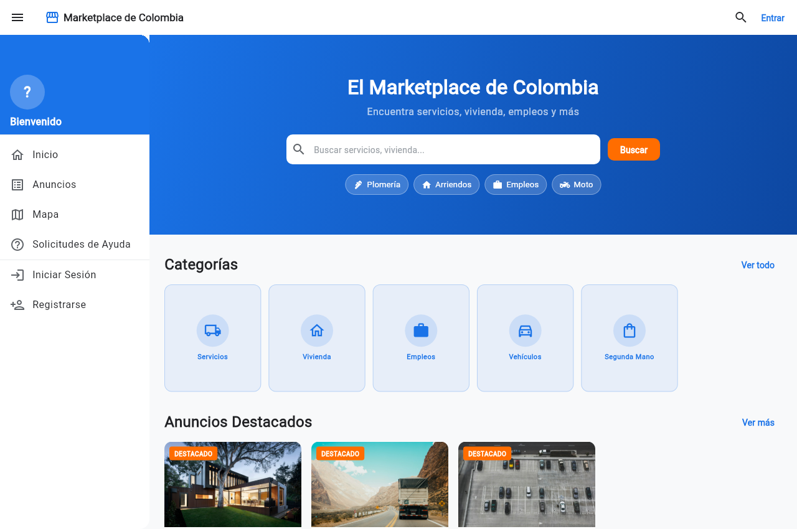
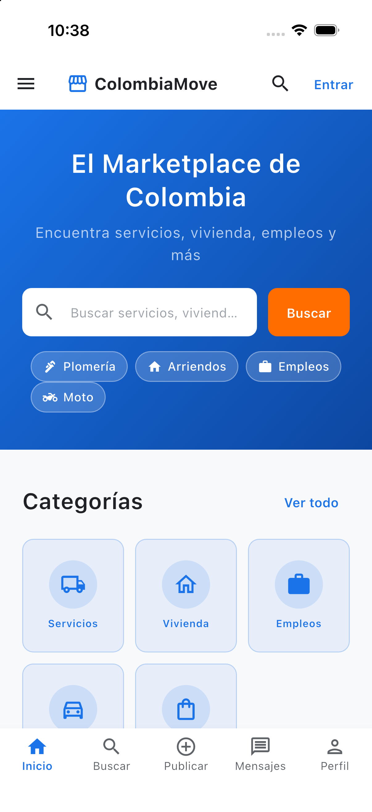
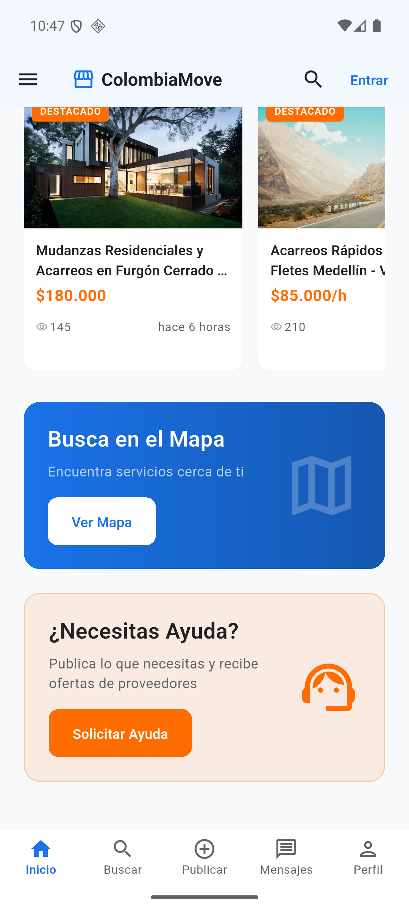

# Marketplace de Colombia - Plataforma Multiplataforma

[](https://flutter.dev)
[](https://hono.dev)
[](https://workers.cloudflare.com)
[](https://developers.cloudflare.com/d1/)
[](https://developers.cloudflare.com/kv/)

Marketplace moderno para Colombia (servicios, acarreos, mudanzas, empleos, arriendos y productos usados). Diseñado para ejecutarse con latencia ultra baja en el Edge de Cloudflare con soporte nativo para **Web**, **iOS** y **Android**.

---

## 🌐 Enlaces en Producción

- **Frontend (Web):** [https://marketplace-colombia.pages.dev](https://marketplace-colombia.pages.dev)
- **Backend API:** [https://marketplace-api.business-alejandrolopezmurillo.workers.dev](https://marketplace-api.business-alejandrolopezmurillo.workers.dev)

---

## 📸 Vistas de la Aplicación

### Versión Web (Escritorio)


### Versiones Móviles (iOS y Android)
| iOS Simulator (iPhone 17 Pro) | Android Emulator (API 36) |
|:---:|:---:|
|  |  |

---

## 🏗 Arquitectura y Tecnologías

### Backend (Edge Serverless)
- **Framework:** [Hono v4](https://hono.dev) sobre **Cloudflare Workers**.
- **Base de Datos:** **Cloudflare D1** (SQLite relacional distribuido globalmente).
- **Almacenamiento de Imágenes:** **Cloudflare KV** (`IMAGES_KV`) con entrega optimizada mediante cabeceras de caché inmutable (`Cache-Control: public, max-age=31536000, immutable`). *No requiere R2*.
- **Sesiones y Rate Limiting:** **Cloudflare KV** (`SESSIONS`, `RATE_LIMIT`, `CACHE`).
- **Autenticación:** JWT stateless + validación de sesiones en KV.
- **Validación:** Zod con tipado estricto en TypeScript.

### Frontend (Multiplataforma)
- **Framework:** **Flutter 3.47+** (Dart 3.13+).
- **Gestión de Estado:** `flutter_riverpod`.
- **Enrutamiento:** `go_router` con soporte de rutas protegidas y deep linking.
- **Cliente HTTP:** `dio` con interceptores de autenticación y manejo de errores.
- **Diseño UI:** Material 3 responsive adaptado para pantallas móviles (iOS/Android) y escritorio/web.

---

## 📁 Estructura del Proyecto

```text
marketplace/
├── backend/                  # API Hono en Cloudflare Workers
│   ├── src/
│   │   ├── db/              # Esquema SQL (schema.sql) y datos semilla (seed.sql)
│   │   ├── middleware/      # Auth JWT, Rate limiting, CORS, Logger
│   │   ├── routes/          # Endpoints (auth, listings, categories, uploads, etc.)
│   │   ├── types/           # Definiciones TypeScript de entorno y modelos
│   │   └── index.ts         # Punto de entrada de la aplicación Hono
│   ├── package.json
│   ├── tsconfig.json
│   └── wrangler.toml        # Configuración de bindings (D1, KV namespaces)
├── frontend/                 # Aplicación Flutter (Web, iOS, Android)
│   ├── lib/
│   │   ├── core/            # Constantes, temas M3, servicios HTTP y router
│   │   ├── features/        # Módulos: auth, home, listings, messages, profile, requests, map
│   │   ├── l10n/            # Internacionalización (es_CO / en_US)
│   │   └── main.dart        # Inicialización de la aplicación
│   ├── android/             # Proyecto nativo Android (Gradle, Kotlin, Manifest)
│   ├── ios/                 # Proyecto nativo iOS (Xcode workspace, Podfile, Info.plist)
│   ├── web/                 # Configuración PWA / Web
│   └── pubspec.yaml         # Dependencias Flutter
└── README.md
```

---

## 🚀 Requisitos Previos

1. **Node.js**: v20 o superior.
2. **Cloudflare Wrangler CLI**: `npm install -g wrangler`
3. **Cuenta de Cloudflare**: Autenticada con `wrangler login`.
4. **Flutter SDK**: v3.24 o superior (`flutter doctor`).
5. **Para iOS**: macOS con Xcode y CocoaPods (`pod --version`).
6. **Para Android**: Android Studio con Android SDK (API 34+) y un emulador configurado.

---

## ⚙️ Guía de Instalación y Ejecución

### 1. Clonar el Repositorio

```bash
git clone https://github.com/hamstersoftwarecol/marketplace-de-colombia.git
cd marketplace-de-colombia
```

---

### 2. Configurar y Ejecutar el Backend

#### Instalar dependencias:
```bash
cd backend
npm install
```

#### Crear recursos en Cloudflare (si es un despliegue nuevo):
```bash
# Crear base de datos D1
npx wrangler d1 create marketplace-db

# Crear namespaces de KV
npx wrangler kv namespace create SESSIONS
npx wrangler kv namespace create RATE_LIMIT
npx wrangler kv namespace create CACHE
npx wrangler kv namespace create IMAGES_KV
```

Actualiza los IDs resultantes en `backend/wrangler.toml`.

#### Aplicar migraciones y datos iniciales:
```bash
# Ejecutar localmente
npx wrangler d1 execute marketplace-db --local --file=src/db/schema.sql
npx wrangler d1 execute marketplace-db --local --file=src/db/seed.sql

# O aplicar directamente en Cloudflare remoto
npx wrangler d1 execute marketplace-db --remote --file=src/db/schema.sql
npx wrangler d1 execute marketplace-db --remote --file=src/db/seed.sql
```

#### Ejecutar el API en desarrollo local:
```bash
npm run dev
# API disponible en http://localhost:8787
```

#### Desplegar a producción en Cloudflare Workers:
```bash
npm run deploy
```

---

### 3. Configurar y Ejecutar el Frontend (Flutter)

Entra a la carpeta `frontend`:
```bash
cd ../frontend
flutter pub get
```

#### A. Ejecutar en Web (Desarrollo local):
```bash
flutter run -d chrome
```

#### B. Compilar y Desplegar Web en Cloudflare Pages:
```bash
flutter build web --release --no-tree-shake-icons
npx wrangler pages deploy build/web --project-name=marketplace-colombia
```

#### C. Ejecutar en Simulador iOS:
```bash
# Instalar CocoaPods
cd ios && pod install && cd ..

# Iniciar simulador y ejecutar
flutter run -d ios
```

#### D. Ejecutar en Emulador Android:
```bash
# Iniciar emulador y ejecutar
flutter run -d android
```

Para generar el instalador APK:
```bash
flutter build apk --debug
# APK generado en: build/app/outputs/flutter-apk/app-debug.apk
```

---

## 📡 Referencia de Endpoints de la API

| Método | Endpoint | Descripción | Auth Requerida |
|---|---|---|---|
| `POST` | `/auth/register` | Registro de nuevo usuario | No |
| `POST` | `/auth/login` | Inicio de sesión (retorna token JWT) | No |
| `POST` | `/auth/logout` | Cierre de sesión e invalidación de token | Sí |
| `GET` | `/auth/me` | Obtener datos del usuario autenticado | Opcional |
| `GET` | `/categories` | Listar categorías activas con iconos | No |
| `GET` | `/listings` | Listar publicaciones (filtro por categoría, ciudad, orden) | No |
| `GET` | `/listings/:id` | Detalle completo de una publicación | No |
| `POST` | `/listings` | Crear nueva publicación | Sí |
| `DELETE` | `/listings/:id` | Eliminar una publicación | Sí |
| `POST` | `/uploads` | Subir imagen (almacena directo en KV) | Sí |
| `GET` | `/images/:id` | Servir imagen optimizada desde KV | No |
| `GET` | `/requests` | Listar solicitudes de ayuda/servicios | No |
| `POST` | `/requests` | Crear solicitud de ayuda | Sí |
| `GET` | `/messages` | Listar conversaciones del usuario | Sí |
| `POST` | `/messages` | Enviar mensaje en una conversación | Sí |

---

## 🔒 Manejo de Imágenes con Cloudflare KV

El sistema no requiere servicios externos de almacenamiento de objetos (como AWS S3 o Cloudflare R2). Las imágenes se procesan de la siguiente manera:
1. El cliente envía la imagen codificada mediante `POST /uploads`.
2. El Worker guarda los bytes en el namespace `IMAGES_KV` con metadata del MIME type.
3. Las imágenes se consumen mediante `GET /images/:id`, retornando cabeceras de caché públicas de larga duración (`31536000s`) que se almacenan automáticamente en la CDN global de Cloudflare.

---

## 📄 Licencia

Este proyecto es de código abierto bajo la licencia [MIT](LICENSE).
